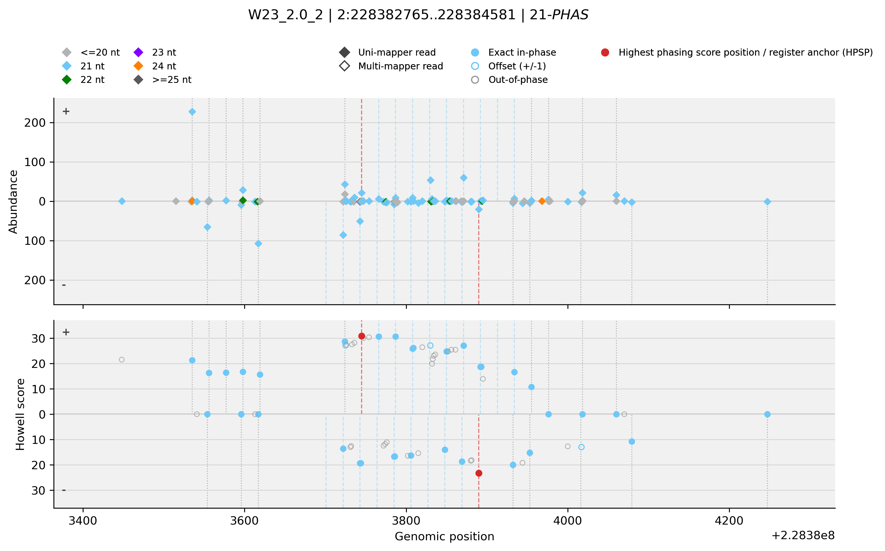

# Phasis - Phased sRNA Cluster Discovery and Annotation

**Version:** v2.8.4
Development validation build; not yet a tagged release. See [release notes](CHANGELOG.md).

Phasis identifies phased small-RNA-producing (*PHAS*) loci from small-RNA
(sRNA) libraries and a reference genome or transcriptome. It reports
high-confidence *PHAS* calls, retains *PHAS*-like candidates for follow-up,
and produces annotation tables, heatmaps, and individual locus plots.

For a first analysis, install Phasis and follow the downloadable example below.
You do not need to change classifiers, choose another aligner, or tune advanced
parameters to get started.

**Start here:** [Install](#installation) | [Run the example](#run-a-real-example) |
[Understand the outputs](#understand-the-outputs) | [Use your own data](#use-your-own-data)

**Go further:** [Manage runs](#manage-runs-and-outputs) |
[Advanced workflows](docs/advanced_usage.md) |
[Bowtie 1 / BWA tutorial](docs/external_bam.md) | [Troubleshooting](#troubleshooting)

## Software History

The original [PHASIS](https://github.com/atulkakrana/PHASIS), described by
Kakrana et al. (2017), remains available for reproducibility. **Phasis 2 is a
complete rewrite**, with a redesigned architecture and implementation, not an
incremental update of that codebase. The capitalization is intentional:
**PHASIS** names the original software; **Phasis** names the rewritten successor.
The maintained implementation is
[blakemeyerslab/Phasis](https://github.com/blakemeyerslab/Phasis).

## Installation

Phasis supports Python 3.10 through 3.12 on Linux and macOS.
The recommended Conda environment includes HISAT2, the default aligner, and
SAMtools. You will also need Git to download the source and `wget` for the example.

### 1. Create an environment

```bash
conda create -n phasis --override-channels -c conda-forge -c bioconda --strict-channel-priority \
  python=3.12 "numpy=1.26.4" "scikit-learn=1.3.2" \
  hisat2 "samtools>=1.10" wget -y
conda activate phasis
```

### 2. Download and install Phasis

```bash
git clone https://github.com/blakemeyerslab/Phasis.git
cd Phasis
python -m pip install -U pip
python -m pip install -e .
phasis -h
```

If you already have a source checkout, run the installation commands from its
root instead of cloning again. Keep analysis files in a separate directory.

The commands above install the default branch. To test the upcoming v2.8.4
without changing an existing installation, clone into a separate directory and
install it in a separate Conda environment:

```bash
git clone --branch dev/v2.8.4 --single-branch https://github.com/blakemeyerslab/Phasis.git Phasis-v2.8.4-dev
cd Phasis-v2.8.4-dev
python -m pip install -e '.[bam]'
phasis -version
git rev-parse HEAD
```

The development branch is mutable. Record the commit alongside the version for
reproducible tests; this branch is not a replacement for the frozen manuscript
archive.

## Run a Real Example

This example downloads four maize tag-count libraries and the B73 RefGen v2
genome, then runs 21-*PHAS* and 24-*PHAS* analyses. It is a real dataset, not a
small demonstration fixture: allow time and disk space for downloading the
genome, building its index, and processing the libraries. Adjust `-cores 12`
to the resources available to your job.

Run the commands in a new analysis directory outside the source checkout:

```bash
mkdir -p ~/phasis_example
cd ~/phasis_example

# Retrieve GEO tag-count libraries.
wget "https://www.ncbi.nlm.nih.gov/geo/download/?acc=GSM3466697&format=file&file=GSM3466697%5F7570%5Fchopped%2Etxt%2Egz" -O sTP_dcl5_1_2.0.tag.gz
wget "https://www.ncbi.nlm.nih.gov/geo/download/?acc=GSM4180401&format=file&file=GSM4180401%5FTP%5FW23%5F2%5F0%5F1%5Fchopped%2Etxt%2Egz" -O W23_2.0_1.tag.gz
wget "https://www.ncbi.nlm.nih.gov/geo/download/?acc=GSM4180402&format=file&file=GSM4180402%5FTP%5FW23%5F2%5F0%5F2%5Fchopped%2Etxt%2Egz" -O W23_2.0_2.tag.gz
wget "https://www.ncbi.nlm.nih.gov/geo/download/?acc=GSM3466699&format=file&file=GSM3466699%5F7569%5Fchopped%2Etxt%2Egz" -O sTR_dcl5_1_2.0.tag.gz

# Download the maize B73 RefGen v2 / AGPv2 genome.
wget https://download.maizegdb.org/B73_RefGen_v2/B73_RefGen_v2.fa.gz

# Detect 21-PHAS loci.
phasis -mindepth 1 -phase 21 -libformat T \
  -reference B73_RefGen_v2.fa.gz -cores 12 -maxhits 25 \
  -libs sTR_dcl5_1_2.0.tag.gz W23_2.0_2.tag.gz sTP_dcl5_1_2.0.tag.gz W23_2.0_1.tag.gz

# Detect 24-PHAS loci, reusing the index and processed libraries.
phasis -mindepth 1 -phase 24 -libformat T \
  -reference B73_RefGen_v2.fa.gz -cores 12 -maxhits 25 \
  -libs sTR_dcl5_1_2.0.tag.gz W23_2.0_2.tag.gz sTP_dcl5_1_2.0.tag.gz W23_2.0_1.tag.gz
```

Results appear in `21_results/` and `24_results/`. Start with the calls table
and the individual locus plots described below. Libraries remain separate by
default; pooling is an optional analysis choice.

## Understand the Outputs

For each phase, Phasis writes final results to `--outdir` (default:
`21_results/` or `24_results/`).

| Output | What it tells you |
| --- | --- |
| `{phase}_calls.tsv` | Main table of high-confidence *PHAS* calls. Start here. |
| `{phase}_classification_evidence.tsv` | Register-resolved evidence for *PHAS*, *PHAS*-like, and non-*PHAS* interpretations. |
| `{phase}_all_clusters.tsv` | Evaluated clusters, including candidates that did not pass final reporting. |
| `{phase}_PHAS.gff` | Coordinates of detected *PHAS* loci for genome annotation or browsing. |
| `{phase}_PHAS.pdf` | Individual-library classification heatmap for loci called in at least one library. |
| `{phase}_Abundance_PHAS.pdf` | Abundance heatmap for loci called as *PHAS* at least once. |
| `{phase}_Abundance_PHAS_and_nonPHAS.pdf` | Abundance heatmap including non-*PHAS* signal at those loci. |
| `{phase}_Howell_scores.pdf` | Individual-library Howell-score heatmaps. |
| `{phase}_PHAS_locus_plots/` | Diagnostic plots for inspecting individual loci. |
| `{phase}_phasiRNAs.tsv` | Phased-register sRNAs associated with final *PHAS* loci. |
| `{phase}_PHAS_like/` | Separate *PHAS*-like calls, evidence, GFF, phasiRNAs, and plots. |

### What is *PHAS*-like?

Phasis evaluates whether a candidate's sRNAs support a coherent phased register:
regularly spaced positions separated by the selected phase length.
High-confidence *PHAS* calls require sufficient exact-register support.
Candidates with phased structure but weaker exact-register support may be
retained as *PHAS*-like for follow-up. They are **not** added to the
high-confidence calls table.

This assessment is performed by the Register-Resolved Locus Interpretation
Layer (RRL), after candidate detection. The evidence table and diagnostic plots
help explain each candidate's interpretation.

### Read an individual locus plot



- **Top panel:** sRNA abundance across the locus, separated by strand. Diamonds
  represent mapped sRNAs; color indicates length and fill distinguishes
  uniquely and multiply mapped reads. Phase-colored halos identify reads
  assigned to the interpreted register.
- **Bottom panel:** score/register context for candidate phased windows.
  The red point is the highest phasing score position, used as the register
  anchor. Hollow gray points are nearby windows that were not promoted;
  rose-colored windows are promoted secondary phased windows.
- **Blue region:** the main phased unit in this example.
- **Sidebar:** register support, final class, opposite-strand partner status,
  coherent extension, and secondary-window evidence.

Use these plots to inspect phased structure, opposite-strand support, and
secondary or overlapping windows rather than relying on a score alone.

## Use Your Own Data

You need sRNA libraries and a reference FASTA. Both library inputs and the
reference can be plain text or gzip-compressed.

| Library format | Option | Preparation |
| --- | --- | --- |
| Tag-count | `-libformat T` | Sequence and abundance per tag. |
| FASTA | `-libformat F` | sRNA sequences. |
| FASTQ | `-libformat Q` | Adapter/quality-trimmed sRNAs, expected to be 18-35 nt. |

Phasis is not an adapter or quality trimmer. FASTQ input is checked and filtered
for invalid, ambiguous, short, and long reads; input that appears to contain raw
sequencing reads triggers an error rather than being silently truncated.

### Choose the phase length

From your analysis directory, use `-phase 21` or `-phase 24`:

```bash
phasis -libs *.tag -libformat T -reference genome.fa -phase 21 -cores 4
phasis -libs *.tag -libformat T -reference genome.fa -phase 24 -cores 4
```

For preprocessed FASTQ libraries:

```bash
phasis -libs sample.fastq.gz other_sample.fastq.gz \
  -libformat Q -reference genome.fa.gz -phase 24 -cores 4
```

### Choose individual or pooled evidence

By default, Phasis analyzes libraries individually. To combine their evidence
into one virtual library, add `--pool_libraries`:

```bash
phasis -libs *.tag -libformat T -reference genome.fa -phase 24 \
  -cores 4 --pool_libraries --outdir 24_results_pooled
```

Pooled mode produces tables, annotations, and individual locus plots, but not
cross-library heatmaps because there is only one virtual library. Neither
evidence mode is guaranteed to recover every locus found by the other.

### Common options

| Option | Meaning |
| --- | --- |
| `-libs` | Input libraries. |
| `-reference` | Reference genome or transcriptome FASTA. |
| `-libformat` | `F` for FASTA, `T` for tag-count, or `Q` for preprocessed FASTQ. |
| `-phase` | Phasing length, commonly 21 or 24. |
| `-cores` | CPU count; `0` uses all available cores within detected allocation limits. |
| `--pool_libraries` | Combine libraries into one virtual library before candidate detection. |
| `--outdir` | Final output directory; supports `{phase}` in its name. |

Run `phasis -h` for all options. Start with the normal filtering settings before
considering [advanced parameter changes](docs/advanced_usage.md#filtering-options).

## Manage Runs and Outputs

| Location | Contents |
| --- | --- |
| **Run directory:** where you execute `phasis` | Intermediates, `index/`, `processed_libraries/`, and the `phasis.mem` cache. |
| **Output directory:** selected by `--outdir` | Final tables, annotations, and plots. |

Keeping 21-*PHAS* and 24-*PHAS* analyses in the same run directory allows reuse
of the index and processed libraries. Phasis stores processed library copies
as `.fas.gz` files and checks its cache to decide which steps can be reused.
Changing `--outdir` changes the location of final results, not the run directory.

Completed Phase II text intermediates are gzip-compressed by default to save
disk space while preserving restart/cache behavior. Use
`--no_compress_intermediates` only when you need plain-text intermediates.

For separate experiments, keep separate run directories. Before deleting
intermediates, read the [cleanup instructions](docs/advanced_usage.md#cleanup):
cleanup preserves final results but removes files that would otherwise be reused.

## Go Further

These workflows are optional; they are not prerequisites for a standard analysis.

| Task | Guide |
| --- | --- |
| Classify existing candidate clusters without repeating discovery | [Reuse candidate files](docs/advanced_usage.md#classify-existing-candidate-clusters) |
| Use Bowtie 1 or BWA-backtrack alignments instead of native HISAT2 mapping | [Alternative-aligner tutorial](docs/external_bam.md) |
| Combine completed runs or evaluate calls against known loci | [Compare results](docs/advanced_usage.md#combine-completed-runs) |
| Convert library formats or manage chromosome names | [Input preparation](docs/advanced_usage.md#input-preparation) |
| Tune memory, temporary disk use, or shared-filesystem performance | [HPC and resource tuning](docs/advanced_usage.md#hpc-and-resource-tuning) |

The alternative-aligner workflow uses `support_scripts/bam_to_candidates.py` for
individual-library, full-length ungapped alignments (exact matches by default).
Optional mismatch tolerance and a single-reported-placement filter are described
in the tutorial. It reuses Phasis clustering,
scoring, and classification; it does not replace the default workflow.
It does not require a prior HISAT2 mapping run. The
[tutorial](docs/external_bam.md#requirements-and-why-they-matter) explains which
settings you can change and which filters Phasis still applies.

## Troubleshooting

- **Classification reproducibility:** This development build fixes GMM
  initialization to `random_from_data`, seed `0`, and one initialization, rather
  than switching methods after an environment error. Calls may differ from
  earlier k-means-initialized runs. See [reproducibility details](docs/advanced_usage.md#classification-reproducibility)
  for the validation scope and why a seed alone cannot guarantee cross-system
  identity.
- **Command not found:** activate your Phasis environment and check `which phasis`,
  `which hisat2`, and `which samtools`.
- **Installation or dependency errors:** use the environment above. NumPy
  `1.26.4` and scikit-learn `1.3.2` are pinned for classifier reproducibility;
  scikit-learn `1.3.2` supports the Python 3.12 Conda installation. SAMtools
  must be version 1.10 or newer; check `samtools --version`.
- **FASTQ input rejected:** confirm adapter/quality trimming and the expected
  sRNA length range before running Phasis.
- **No plots:** first check whether final *PHAS* or *PHAS*-like calls were
  produced, then check the [plot-staging settings](docs/advanced_usage.md#plot-staging).
- **Plot fonts:** Phasis uses Matplotlib's bundled DejaVu Sans with normal/bold
  weights, including math text, without requiring custom fonts or TeX. Font
  settings are scoped to rendering and restored afterward. If a shared system
  reports an unwritable font cache, set `MPLCONFIGDIR` (and `XDG_CACHE_HOME` for
  fontconfig) to writable directories before launching Phasis.
- **High RAM or temporary disk use:** see [resource tuning](docs/advanced_usage.md#hpc-and-resource-tuning).
  More CPU workers can increase concurrent memory and disk demand.

When reporting a problem, include the command, Phasis version, relevant log
messages, input format, and whether you reused a run directory. Do not share
private sequencing data or credentials in a public issue.

## Authors

- Thales Henrique Cherubino Ribeiro - thalescherubino@gmail.com
- Atul Kakrana - kakrana@gmail.com
- Blake Meyers - bcmeyers@ucdavis.edu
